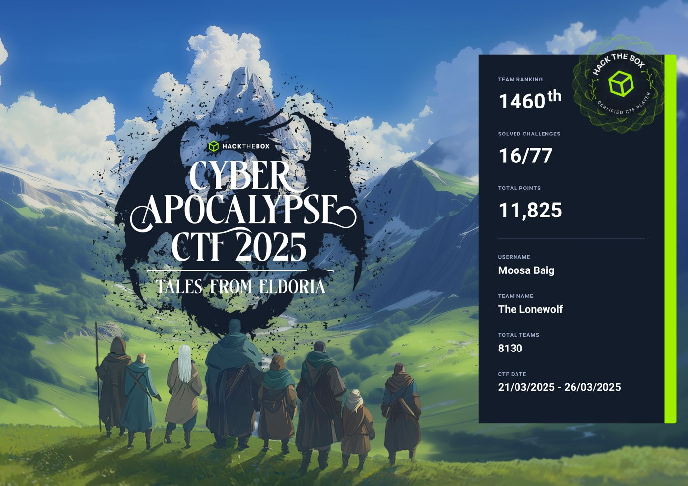

<!-- Header -->

  

  

  
  
  
  

---

## About Me

I am a **Cybersecurity Professional** specialising in **Vulnerability Assessment and Penetration Testing (VAPT)**. I identify and exploit security flaws across web applications, APIs, networks and infrastructure, then turn findings into clear, prioritised remediation guidance that engineering and leadership teams can act on.

- 🔍 **Offensive testing** of web applications, APIs, networks and infrastructure
- 📊 **Risk assessment** with severity-rated findings and practical remediation plans
- 📝 **Security reporting** for both technical teams and business stakeholders
- 🏁 **CTF player** — Hack The Box Cyber Apocalypse CTF 2025
- 🌱 Currently growing in **cloud security** and **DevSecOps**

---

## Core Competencies

| Area | Focus |
|:--|:--|
| **Penetration Testing** | Web apps, APIs, internal & external networks |
| **Vulnerability Assessment** | Discovery, validation, false-positive triage, severity rating |
| **Application Security** | OWASP Top 10, OWASP API Security Top 10 |
| **Risk & Remediation** | Risk assessment, mitigation strategy, retesting |
| **Documentation** | Executive summaries, technical reports, proof-of-concept write-ups |
| **Incident Response** | Triage and analysis fundamentals |

---

## Toolkit

**Security Testing**

  
  
  
  
  
  

**Languages & Scripting**

  
  
  

**Operating Systems**

  
  
  
  
  

**Cloud**

  

---

## Certifications & Achievements

<table>
  <tr>
    <td align="center" width="25%">
      
       <b>Google Cybersecurity Professional Certificate</b>
       Google · Credly
    </td>
    <td align="center" width="25%">
      
       <b>APIsec Certified Practitioner</b>
       APIsec University · Credly
    </td>
    <td align="center" width="25%">
      
       <b>Oracle Cloud Infrastructure Foundations 2025</b>
       Oracle
    </td>
    <td align="center" width="25%">
      
       <b>Cyber Apocalypse CTF 2025</b>
       Hack The Box
    </td>
  </tr>
</table>

---

## GitHub Activity

  
  

---

## Let's Connect

I'm open to opportunities and collaboration in **penetration testing**, **application security** and **security consulting**.

  

  

